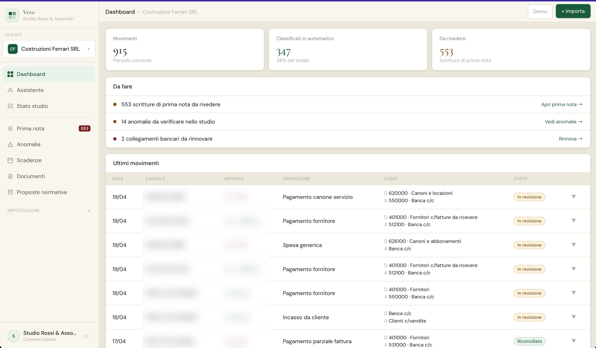

# Vero

**Bank reconciliation for Italian accounting firms.** Vero read a client's bank transactions, proposed the accounting entry for each one, and let the accountant confirm.

Built March to June 2026 with a team of three. I developed the whole product. **Discontinued in July 2026**, when TeamSystem, the market leader, shipped AI reconciliation inside its own software.

Demo firm data. Transaction descriptions and amounts are blurred.

## How it classified a transaction

A cascade, cheapest step first:

1. **General rules** for the common, unambiguous cases.
2. **The firm's own rules**, learned from the accountant's corrections.
3. **Embedding search** over transactions already confirmed (OpenAI embeddings stored in pgvector).
4. **An LLM** (Claude or OpenAI), only for what's left.

A separate confidence engine, with no LLM in it, decided what happened next: above 90 the entry was booked automatically, between 70 and 90 it was proposed, below 70 it went to a person. Every correction became a rule for that firm.

## What was in it

- Bank feeds through open banking (TrueLayer, PSD2, sandbox) and a test with a real N26 statement
- Parser for Italian e-invoices (SDI XML), matched against payments
- Automatic *prima nota* (journal entries), anomalies, deadlines
- Background jobs with Redis and RQ

## Stack

Python · FastAPI · React + Vite · Supabase (Postgres, pgvector) · Redis / RQ · Claude API · OpenAI API · n8n · 42 pytest tests

The code is private. Happy to walk through the architecture and what I learned from shutting it down.
